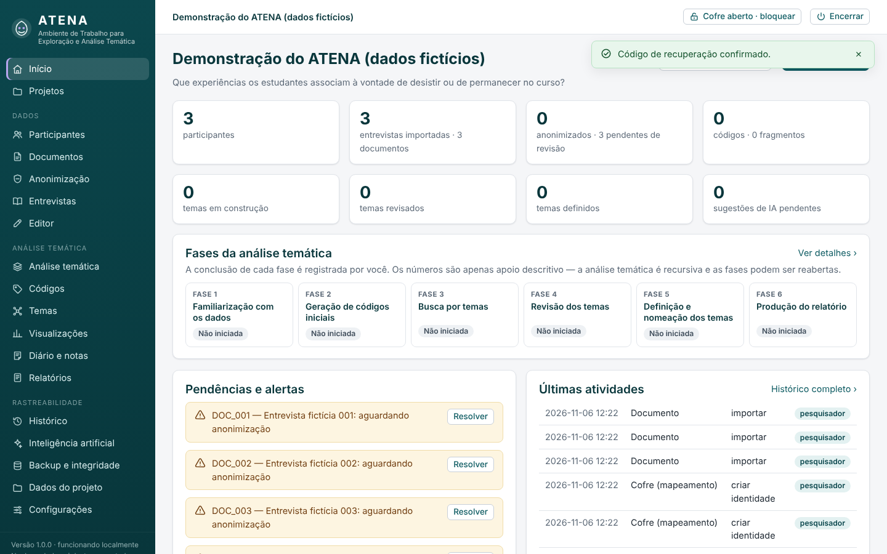

# ATENA — Ambiente de Trabalho para Exploração e Análise Temática

Software **local** de apoio à pesquisa qualitativa, do documento bruto ao relatório final, seguindo a
**análise temática de Braun e Clarke (2006)**. Funciona inteiramente no computador do pesquisador, sem
internet, com banco de dados persistente, cofre criptografado para dados identificáveis, histórico
append-only de todas as decisões e integração **opcional** com a API da OpenAI.



## O que o ATENA faz

| Etapa | Recursos |
|---|---|
| Projetos | Vários projetos independentes, cada um com seus dados, configurações, histórico e cofre. Criar, editar, arquivar, exportar, fazer backup e restaurar. |
| Documentos | Importa PDF, DOCX, ODT, RTF, TXT, MD, CSV/TSV, HTML, SRT e VTT; também aceita texto colado. O original é preservado e **cifrado**. |
| Anonimização | Detecção local de nomes, e-mails, telefones, CPF/RG/CNPJ, endereços/CEP, matrículas, links e perfis; **revisão humana obrigatória** item a item; termos protegidos (ex.: Empresas Juniores e IES); códigos `PARTICIPANTE_001`, `PESSOA_001`… consistentes em todo o projeto; mapeamento reversível cifrado. |
| Familiarização (fase 1) | Leitura integral, diário de familiarização, ideias iniciais, padrões, trechos relevantes, registro de leituras. |
| Editor | Edição com versões imutáveis, comparação, restauração, busca, e **realocação automática dos fragmentos** codificados (com sinalização dos que ficaram inconsistentes). |
| Codificação (fase 2) | Seleção de trechos com o mouse, vários códigos por fragmento, livro de códigos com descrição/justificativa, mesclagem, exclusão reversível, evidências por código. |
| Temas (fases 3–5) | Mapa temático interativo (arrastar códigos entre temas), subtemas, revisão de nível 1 e 2, fusão, divisão, descarte, sinais de sobreposição, definição e nomeação com confirmação. |
| Relatório (fase 6) | Rascunhos gerados a partir da análise, citações **vinculadas aos fragmentos** (`[[frag:N]]`), verificação de citações não rastreáveis, versões, aprovação, exportação DOCX/PDF/MD/HTML. |
| Visualizações | Matriz código × participante, temas × entrevistas, frequência descritiva, comparação de entrevistas, linha do tempo das decisões, exploração lexical (frequência e KWIC). Toda célula leva aos fragmentos de origem. |
| Rastreabilidade | Histórico append-only com cadeia de hashes, pesquisável, com estado anterior/posterior, origem (pesquisador/IA/sistema) e restauração registrada como nova operação. |
| IA (opcional) | Sugestões de códigos, agrupamentos, nomes, sínteses, coerência, comparação de temas, verificação de privacidade e revisão de texto — sempre com prévia, verificação de privacidade e autorização explícita; citações inventadas são descartadas. |
| Segurança | Cofre AES-256-GCM com senha (scrypt) + código de recuperação, chave da API protegida pelo Windows (DPAPI), interface só em `127.0.0.1` com token, CSRF e CSP, backups automáticos e verificação de integridade. |

## Começo rápido (Windows)

**Opção A — executável:** gere `ATENA.exe` (ver [Manual de instalação](docs/MANUAL_DE_INSTALACAO.md)) e dê dois cliques.

**Opção B — a partir do código-fonte:** instale o Python 3.11+ (marcando *Add python.exe to PATH*) e dê dois
cliques em **`Iniciar_ATENA.bat`**. Na primeira execução ele prepara o ambiente (precisa de internet uma única vez);
depois, abre o ATENA no navegador.

Para conhecer o sistema sem dados reais, clique em **“Explorar um projeto de demonstração (dados fictícios)”**
na tela inicial (senha do cofre da demonstração: `demonstracao-atena`).

## Documentação

- [Manual de instalação](docs/MANUAL_DE_INSTALACAO.md)
- [Manual de utilização](docs/MANUAL_DE_UTILIZACAO.md)
- [Tutorial: configurar a API da OpenAI](docs/TUTORIAL_API_OPENAI.md)
- [Backup e restauração](docs/BACKUP_E_RESTAURACAO.md)
- [Arquitetura e decisões técnicas](docs/ARQUITETURA.md)
- [Segurança, privacidade e limitações](docs/SEGURANCA_PRIVACIDADE_E_LIMITACOES.md)
- [Relatório de entrega: funcionalidades e testes executados](docs/RELATORIO_DE_ENTREGA.md)
- [Licenças de terceiros](docs/LICENCAS_DE_TERCEIROS.md)

## Testes

```bash
pip install -r requirements-dev.txt
python -m playwright install chromium   # opcional, para o teste no navegador
python -m pytest                        # 107 testes, somente com dados fictícios
```

## Estrutura

```
atena/                 código-fonte (pacote Python)
  servicos/            regras de negócio (projetos, importação, PII, anonimização, codificação, temas, IA, relatórios…)
  web/                 interface local (Flask, páginas HTML, CSS e JavaScript sem dependências externas)
  recursos/            listas de termos protegidos, prenomes, palavras vazias
testes/                testes automatizados (pytest + Playwright)
empacotamento/         PyInstaller (.spec), Inno Setup (.iss), ícone
docs/                  manuais, tutorial, arquitetura, relatório de entrega
Iniciar_ATENA.bat      executa a partir do código-fonte
construir_windows.bat  testa e gera o executável/instalador
```
