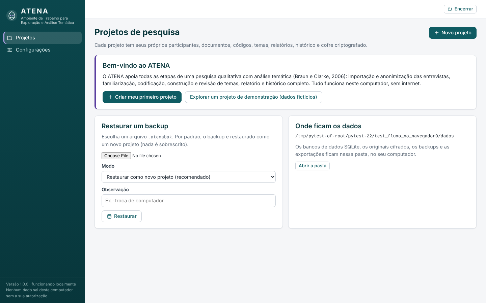
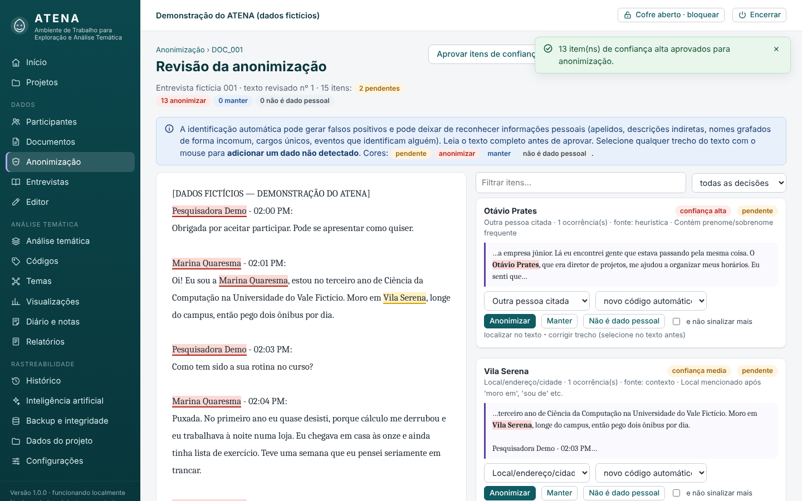
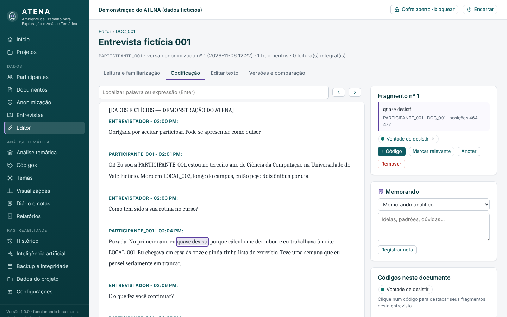
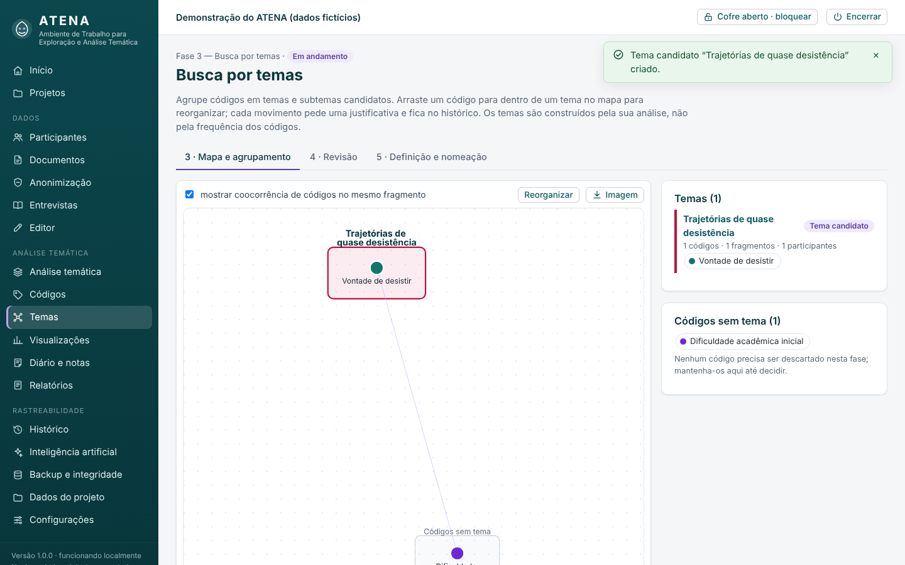
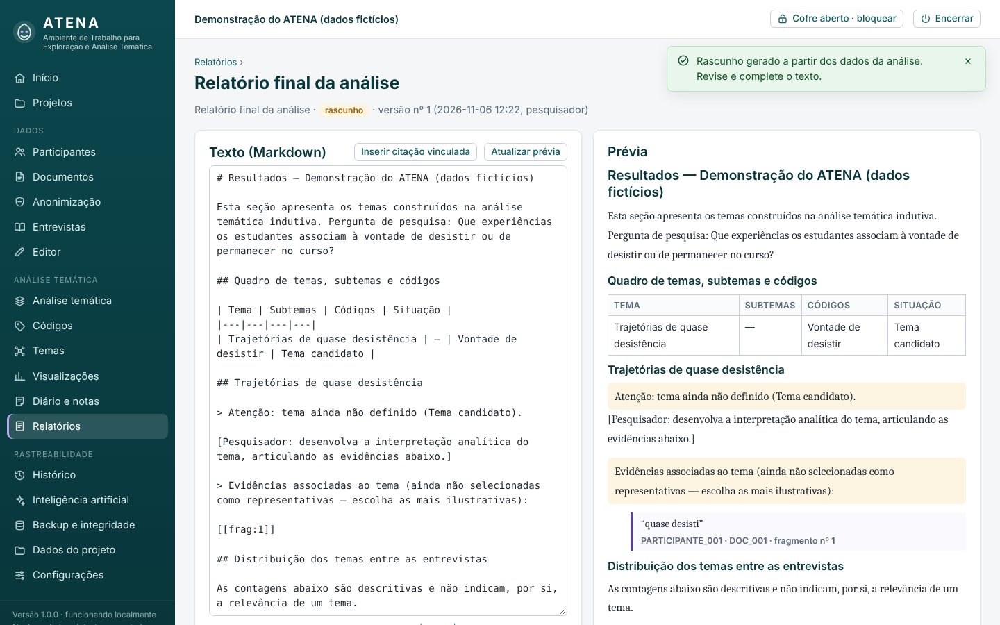
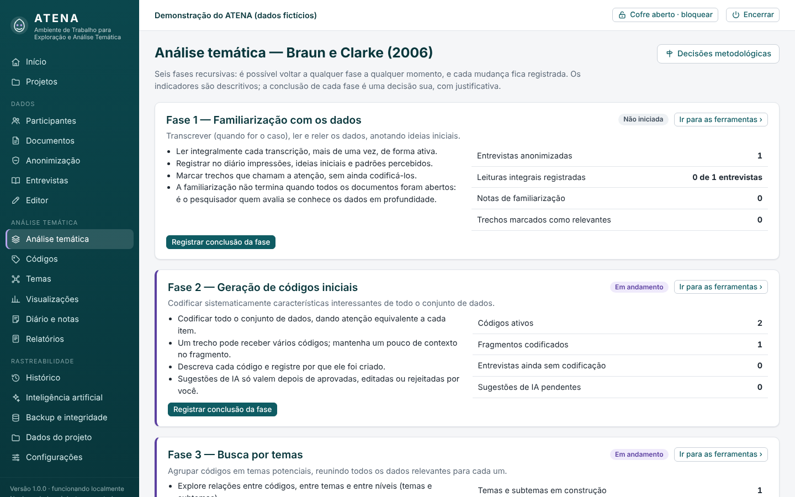
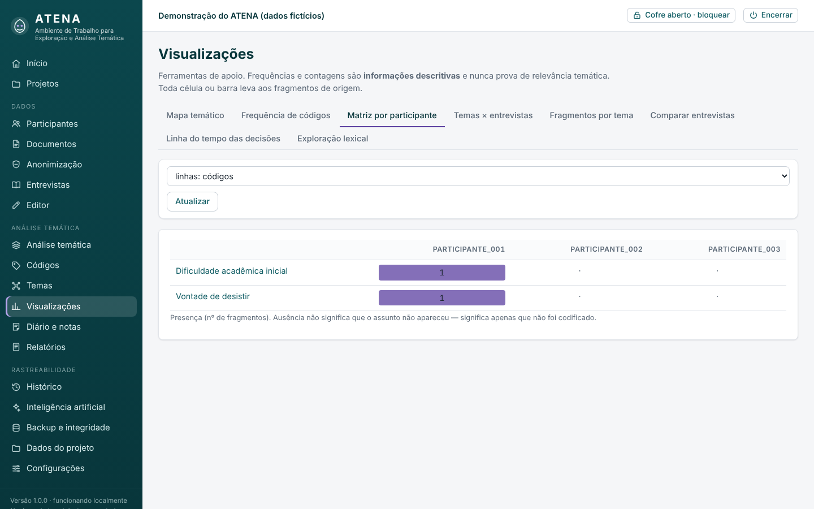
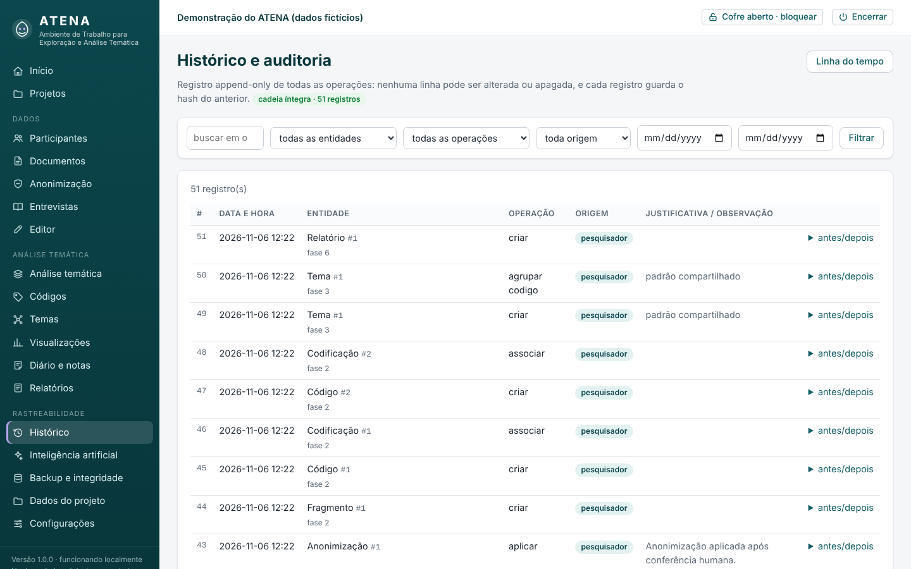

# Manual de utilização do ATENA

Este manual segue o caminho de uma pesquisa: do projeto ao relatório. Para praticar sem dados reais, use o
**projeto de demonstração** (tela inicial › “Explorar um projeto de demonstração”; senha do cofre:
`demonstracao-atena`). As entrevistas da demonstração são inteiramente fictícias.

## Conceitos essenciais

- **Zona de trabalho × zona protegida (cofre).** A análise usa apenas texto anonimizado. Originais, textos
  antes da anonimização e a tabela “código → identidade” ficam no **cofre**, cifrados, e só abrem com a senha.
- **Versões, não sobrescrita.** Cada documento tem: 1) original; 2) texto extraído; 3) versões revisadas
  (antes da anonimização); 4) versões anonimizadas (a usada na análise). Nenhuma substitui a anterior.
- **Nada é apagado silenciosamente.** Excluir um código, descartar um tema, arquivar uma nota ou um documento
  são operações reversíveis e registradas no histórico, com justificativa.
- **Você decide.** O ATENA sugere, sinaliza e organiza; quem anonimiza, codifica, agrupa, define temas e
  conclui fases é o pesquisador. Sugestões de IA só têm efeito depois que você as aceita.

---

## 1. Criar o projeto

**Projetos › Novo projeto.** Preencha nome, descrição, problema, pergunta, objetivo, metodologia e referências
(pode completar depois em *Dados do projeto*). Defina a **senha do cofre** (mínimo 8 caracteres).

Em **Termos protegidos**, marque as listas prontas — para a sua pesquisa, *“IES e Empresas Juniores do Paraná”*
(herdada do sistema anterior) — e acrescente outros termos que **nunca** devem ser substituídos.

Ao criar, o ATENA mostra **uma única vez** o **código de recuperação** do cofre. Guarde-o fora do computador
(papel ou gerenciador de senhas). Se perder a senha **e** o código, o mapeamento e os originais ficam ilegíveis.

O botão **Cofre aberto/bloqueado**, no topo, mostra o estado do cofre. Ele se bloqueia sozinho após 20 minutos
sem uso (configurável).

## 2. Participantes

**Participantes › Novo participante.** O código (`PARTICIPANTE_001`, `002`…) é gerado automaticamente e é
único no projeto. Registre somente **metadados não identificáveis** (curso, etapa, vínculo…); os campos sugeridos
são definidos em *Dados do projeto › Campos de participante*. A situação acompanha a entrevista (prevista,
agendada, realizada, transcrita, anonimizada, em análise, desistiu).

O **nome real é opcional** e fica só no cofre. Vale a pena registrá-lo (com apelidos em “variantes”, separados por
`;`): assim o ATENA reconhece o nome em todos os documentos e usa sempre o mesmo código.

## 3. Importar documentos

**Documentos.** Com o cofre aberto, importe um ou vários arquivos (PDF, DOCX, ODT, RTF, TXT, MD, CSV, TSV, HTML,
SRT, VTT) ou **cole** a transcrição. Associe ao participante e informe a data da coleta.

- O formato recomendado de transcrição é o do Scribbl, que o ATENA reconhece: `Nome do locutor - 10:01 AM:` numa
  linha e a fala abaixo. CSV com colunas *locutor/texto/horário* e legendas SRT/VTT são convertidos para esse formato.
- O **nome original do arquivo** (que muitas vezes contém o nome do participante) fica apenas no cofre; na zona de
  trabalho o documento é identificado por `DOC_001`, `DOC_002`…
- Se o texto já estiver anonimizado (por exemplo, as transcrições `PARTICIPANTE_XXX.txt` do sistema anterior),
  marque **“O texto já está anonimizado”**.
- **Importar do sistema anterior:** envie o ZIP da pasta `Desenvolvimento`. O ATENA traz as transcrições
  processadas, a ficha de participantes (`dados/participantes.csv`) e os termos protegidos; se você enviar também o
  arquivo `chave.key` (em `C:\Users\<você>\.tcc_evasao\`), o mapeamento antigo é recifrado no cofre do ATENA.

Na página do documento você vê as quatro versões, baixa o original (exige cofre aberto; o acesso é registrado) e
pode **revisar o texto antes da anonimização** (ex.: corrigir palavras conferindo com o áudio). Cada revisão vira
uma nova versão protegida, com observação obrigatória.

## 4. Anonimização (revisão humana obrigatória)

**Anonimização › Iniciar revisão › Detectar e iniciar revisão.**

À esquerda, o texto com os itens destacados (amarelo = pendente, vermelho = anonimizar, azul = manter, cinza = não é
dado pessoal). À direita, os itens agrupados por valor, com contexto, confiança e origem da detecção
(mapeamento, padrão, rótulo de locutor, contexto, heurística de nomes).

Para cada grupo:
- **Anonimizar** — escolha a categoria e o código (um código existente, “novo código automático” ou “digitar
  código…”). O mesmo valor recebe o mesmo código em todos os documentos.
- **Manter** — é dado pessoal, mas deve permanecer (a decisão e a observação ficam registradas).
- **Não é dado pessoal** — falso positivo. Marque “e não sinalizar mais” para adicioná-lo às exceções do projeto.
- **Decidir ocorrência por ocorrência** — quando um mesmo termo é nome em um lugar e palavra comum em outro.
- **Corrigir trecho** — selecione no texto o trecho correto e clique em “corrigir trecho”.
- **Adicionar o que não foi detectado** — selecione qualquer trecho com o mouse e clique em
  **“Marcar como dado pessoal”** (pode marcar todas as ocorrências de uma vez).

“Aprovar itens de confiança alta” aprova de uma vez o que já está no mapeamento e os padrões fixos (e-mails,
telefones…). **Prévia do resultado** mostra o texto final sem gravar nada.

**Aplicar anonimização** só é liberado quando não há itens pendentes, e exige que você confirme ter lido o
documento inteiro. O ATENA cria a versão anonimizada, verifica resíduos (valores do mapeamento que continuam no
texto) e registra tudo no histórico — sem gravar valores identificáveis no banco de trabalho.

> **Atenção:** a detecção automática não é perfeita. Ela pode não reconhecer apelidos, descrições indiretas
> (“a única professora de libras do campus”), eventos singulares e nomes grafados de forma incomum. Leia o texto.

Para **refazer** a anonimização (por exemplo, depois de corrigir o texto protegido), abra a anonimização do
documento de novo: será criada uma nova versão anonimizada e os fragmentos já codificados serão realocados.

## 5. Fase 1 — Familiarização (Entrevistas)

**Entrevistas** lista o corpus, as leituras registradas e o **diário de familiarização**. Clique em **Ler** para
abrir o editor no modo *Leitura e familiarização*:
- selecione um trecho e clique em **Marcar como relevante** ou **Anotar**;
- registre impressões no diário (familiarização, ideia inicial, padrão percebido, reflexividade);
- ao terminar uma leitura completa, clique em **Registrar leitura integral**.

Abrir um documento não conclui nada: a fase só é concluída quando você a registra como concluída em
**Análise temática**, escrevendo por que a considera concluída.

## 6. Editor de transcrições

Abas: **Leitura**, **Codificação**, **Editar texto** e **Versões e comparação**.
- **Localizar**: digite e pressione Enter; use as setas para navegar entre as ocorrências.
- **Editar texto**: salvar cria uma nova versão (observação obrigatória). O ATENA realoca cada fragmento:
  intacto → continua `ok`; texto reencontrado em outra posição → `realocado` (confira); texto alterado ou
  removido → **`inconsistente`** (o texto original do fragmento é preservado e o fragmento fica sinalizado em
  vermelho). Revise em *Início › Pendências* ou clicando no trecho: “Aceitar trecho atual” ou “Usar a seleção
  atual”. Se a edição introduzir algo que parece dado pessoal, o ATENA avisa.
- **Versões**: compare quaisquer duas versões (linhas removidas/inseridas) e restaure uma versão antiga
  (a restauração vira uma nova versão).
- Se você salvar a partir de uma página desatualizada (outra aba salvou antes), o ATENA recusa para não
  sobrescrever.

## 7. Fase 2 — Códigos

No modo **Codificação**, selecione um trecho com o mouse e clique em **Codificar**. No diálogo, marque códigos
existentes e/ou crie um novo (nome, descrição) e, se quiser, justifique a associação. O mesmo trecho pode
receber vários códigos e o mesmo código pode ter vários trechos.

Clique num trecho destacado para ver, no painel lateral, seus códigos, temas e notas; adicione ou retire
códigos, marque como relevante, anote, peça sugestões de IA ou remova o fragmento (com justificativa).
Em “Códigos neste documento”, clique num código para destacar seus fragmentos.

**Códigos** é o livro de códigos: descrição, contagens (descritivas), temas, origem (manual/IA). Na página de
cada código: todas as **evidências**, agrupadas por participante e entrevista, com link para o contexto; editar;
**mesclar** em outro código; **excluir** (reversível) e **restaurar**; histórico completo.
**Comparar entre entrevistas** mostra a matriz código × entrevista; cada célula abre os fragmentos.

## 8. Fase 3 — Busca por temas (mapa temático)

**Temas › Novo tema**: nome provisório, códigos agrupados e justificativa do agrupamento (pode ser subtema de
outro tema). No **mapa**: retângulos são temas (subtemas tracejados dentro deles); círculos são códigos.
**Arraste um código** para outro tema — ou para “Códigos sem tema” — e informe a justificativa: a mudança é
gravada e registrada. Linhas lilás indicam códigos aplicados ao mesmo fragmento (coocorrência, apenas descritiva).
Duplo clique abre o tema/código. “Imagem” baixa o mapa em PNG.

## 9. Fase 4 — Revisão dos temas

**Temas › 4 · Revisão** mostra todos os temas, possíveis **sobreposições** (códigos em comum, índice de Jaccard
dos fragmentos) e **sinais** (tema com um único código, evidências de um só participante, revisões pendentes,
definição desatualizada). São pistas — o sistema não decide.

Na página de cada tema: leia todos os fragmentos (nível 1), confira a distribuição pelas entrevistas e volte às
entrevistas sem evidências (nível 2). **Registrar revisão** guarda coerência, distinção, sobreposições, decisão e
observação. Ali também: retirar/agrupar códigos, mudar hierarquia (subtema), **dividir**, **fundir**,
**descartar** e reativar — sempre com justificativa.

## 10. Fase 5 — Definição e nomeação

**Temas › 5 · Definição** (ou “Definir e nomear” na página do tema): nome, **conceito central**, descrição,
escopo, limites, relação com a pergunta de pesquisa, justificativa. Marque **evidências representativas** na
página do tema. **Confirmar definição** exige conceito central, descrição, ao menos um código (ou subtema) e
uma evidência representativa. Se o tema mudar depois (novo código, evidência…), ele aparece como
“definição desatualizada” até ser reconfirmado.

## 11. Fase 6 — Relatórios e exportação

**Relatórios › Gerar**:
- **Relatório final** — quadro de temas/subtemas/códigos, cada tema com sua definição e evidências, e a
  distribuição dos temas pelas entrevistas;
- **Relatório metodológico** — problema, pergunta, abordagem, corpus, procedimento de anonimização (com
  contagens por categoria), desenvolvimento das fases (com os seus registros de conclusão), decisões
  metodológicas e uso de IA.

O texto é Markdown simples (`#` títulos, `**negrito**`, `- listas`, `| tabelas |`). **Citações não são
digitadas**: use **Inserir citação vinculada**, que insere `[[frag:N]]`; na prévia e na exportação essa marca vira
a fala exata, com `PARTICIPANTE_00X`, documento e número do fragmento (citação longa com recuo de 4 cm, padrão
ABNT, no DOCX/PDF). A verificação aponta citações para fragmentos removidos ou inconsistentes, trechos entre aspas
que não existem nas transcrições, dados identificáveis e trechos de IA não revisados. Cada salvamento é uma
versão; **Aprovar versão** registra a sua revisão final. Exporte em **DOCX, PDF, Markdown ou HTML**.

**Exportar dados** (formatos abertos): participantes, entrevistas, transcrições anonimizadas, diário, códigos,
fragmentos por código, temas e subtemas, evidências por tema, decisões, histórico e registro de IA — em XLSX,
CSV, JSON, ZIP (CSV + XLSX + TXT) ou DOCX (transcrições). O mapeamento de identidades **não** sai nas exportações
comuns: use a **exportação protegida** no Cofre (senha do cofre + justificativa + senha de exportação; gera
`.atenaseg`, aberto em *Configurações › Abrir pacote protegido*).

## 12. Análise temática, notas e decisões

**Análise temática** mostra as seis fases com orientações, indicadores descritivos e os botões **Registrar
conclusão da fase** (justificativa obrigatória) e **Reabrir fase** (motivo obrigatório).

**Diário e notas** reúne todas as notas (filtros por tipo, fase e texto); editar preserva a versão anterior no
histórico. **Decisões metodológicas** registra escolhas e justificativas, que entram no relatório metodológico.

## 13. Visualizações

Frequência de códigos, matriz por participante (códigos ou temas), temas × entrevistas, fragmentos por tema,
comparação entre duas entrevistas, linha do tempo das decisões e exploração lexical (termos e bigramas mais
frequentes, sem palavras vazias nem falas do entrevistador; concordância KWIC). **Toda contagem é descritiva** e
leva aos fragmentos de origem (*Consulta de fragmentos*, com filtros combináveis).

## 14. Histórico

Todas as operações, com data e hora, entidade, operação, estado anterior/posterior, justificativa e origem
(pesquisador, IA ou sistema). Pesquisa por texto e filtros por entidade, operação, origem e período. O selo
**cadeia íntegra** indica que nenhum registro foi alterado fora do ATENA. Quando aplicável, **restaurar** aplica o
estado anterior como uma nova operação (nada é apagado).

## 15. Inteligência artificial (opcional)

Veja o [tutorial de configuração](TUTORIAL_API_OPENAI.md). Pontos de uso: “✦ Sugerir códigos (IA)” na barra de
seleção do editor; agrupamentos no mapa; coerência, nomes, organização de evidências e síntese na página do tema;
revisão de texto no relatório; verificação de privacidade e comparação de temas no painel de IA.

Fluxo: **Preparar** → tela de prévia com (1) finalidade, (2) conteúdo exato, (3) verificação de privacidade e
(4) autorização → **Enviar** → as respostas viram **sugestões pendentes** (aceitar, editar e aceitar, ou rejeitar).

## 16. Backup, integridade e configurações

Veja [Backup e restauração](BACKUP_E_RESTAURACAO.md). Em **Configurações**: IA, chave da API, backup automático,
tempo de bloqueio do cofre, cópia extra dos backups (pendrive/nuvem), backup completo e abertura de pacote
protegido. **Backup e integridade › Verificar integridade** confere bancos, cadeia de hashes, versões, originais
e fragmentos.

## Atalhos e dicas

- Selecione trechos com o mouse; a barra de ações aparece logo acima da seleção.
- `Enter` na busca vai para a próxima ocorrência; `Shift+Enter`, para a anterior.
- Toda operação potencialmente destrutiva pede confirmação e justificativa.
- Ao terminar, use **Encerrar** (os dados já estão salvos a cada operação).
